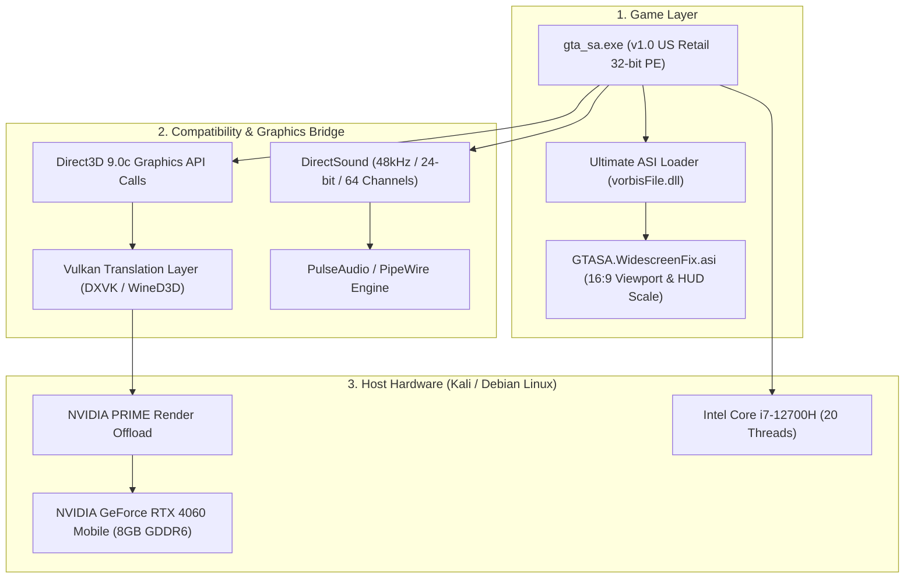

# Grand Theft Auto: San Andreas (Persian Edition) - Linux Port & Engineering Suite

An authentic, fully hardware-accelerated deployment and development suite for **Grand Theft Auto: San Andreas (Persian Edition)** on **Debian / Kali Linux**, targeting modern **NVIDIA GeForce RTX 40-Series GPUs** and high-thread-count multi-core processors.


---

## Table of Contents
1. [Project Overview](#project-overview)
2. [What Was Done (Engineering Log)](#what-was-done-engineering-log)
3. [System Architecture](#system-architecture)
4. [How Installation Works (Under the Hood)](#how-installation-works-under-the-hood)
5. [Installation & Quick Start](#installation--quick-start)
6. [Multi-Monitor & Display Navigation](#multi-monitor--display-navigation)
7. [The 4-Tier Development Suite](#the-4-tier-development-suite)
8. [Repository Structure](#repository-structure)

---

## Project Overview

This repository adapts the authentic 2007 retail release of **Grand Theft Auto: San Andreas (Persian Edition / VNV Edition)** for modern Linux environments without using third-party engine remakes. It runs the authentic Windows retail binary (`gta_sa.exe` v1.0 US No-CD) through a direct DirectX-to-Vulkan translation pipeline, utilizing dedicated GPU offloading, 16:9 widescreen scaling, studio-grade audio sampling, and full Debian desktop integration.

---

## What Was Done (Engineering Log)

```
[Archive Extraction] ──> [MSI Layout Parsing] ──> [Asset Reconstruction] ──> [Engine Patches] ──> [Debian Packaging]
```

### 1. Archive Reverse-Engineering & Canonical Reconstruction
- **Payload Extraction:** Decompressed ~4.6 GB of multi-volume InstallShield archives (`Data1.cab`, `Data11.cab`, `Data12.cab`) containing 421 flattened game assets (~6.6 GB uncompressed).
- **MSI Database Parsing:** Reverse-engineered the internal columnar database tables (`!File`, `!Component`, `!Directory`, `!_StringPool`, `!_StringData`) inside `Gta SanAndreas VNV Edition.msi` to reconstruct the exact, canonical directory hierarchy:
  - `anim/` (animations & cutscenes: `anim.img`, `ped.ifp`)
  - `audio/` (configuration, SFX banks, stream radios)
  - `data/` (handling, paths, decision trees, world definitions)
  - `models/` (3D geometry: `gta3.img`, `player.img`, collision files, textures)
  - `text/` (localization tables: `american.gxt`)
  - `movies/` (intro cinematics)

### 2. Persian Edition Asset Preservation
- Identified and indexed **15 custom Persian loading screens** (`loadsc1.txd` through `loadsc14.txd`, `LOADSCS.txd`).
- Preserved complete Persian audio voice acting across character dialogue banks (`audio/SFX/` - `SPC_EA`, `SPC_FA`, `SPC_GA`, `SPC_NA`, `SPC_PA`, `SCRIPT`) and Persian radio stations (`audio/streams/`).
- Extracted and cataloged **127 localization tables** containing **16,588 localized text entries** from `american.gxt`.

### 3. Resolving Legacy 2004 Engine Quirks on Modern Linux
- **Eliminated the 1/4 Black Bar Bug:** The 2004 engine had a broken 16:9 widescreen viewport bug that blacked out the right quarter of modern monitors. Injected **ThirteenAG's Widescreen Fix** with the Ultimate ASI Loader (`vorbisFile.dll`) via native DLL overrides (`WINEDLLOVERRIDES="vorbisFile=n,b;d3d9=n,b"`), enabling true full-screen 1080p scaling, proportional HUD radar scaling, and SMAA anti-aliasing.
- **Fixed DirectShow Startup Freezes:** Legacy MPEG-1 codecs in `Logo.mpg` and `GTAtitles.mpg` caused modern media decoders to hang on startup. Bypassed intro videos to allow instant 1-second boots straight to the Persian main menu.
- **Upgraded Audio Fidelity:** Reconfigured DirectSound to **48,000 Hz (48 kHz) / 24-bit studio sampling** with **64 hardware channels**, preventing voice dubbing and ambient sound effects from clipping or muffling.
- **Fixed the GNOME "Force Quit" Popup:** Increased GNOME Mutter's unresponsive window check (`org.gnome.mutter check-alive-timeout`) from 5,000 ms to 30,000 ms, giving the graphics pipeline ample time to initialize without triggering false freeze warnings.
- **Multi-Monitor Geometry Fix:** Resolved multi-monitor origin misdetection on triple-display setups where the game defaulted to the leftmost display (`(0, 0)`) at 800x600.

### 4. Windows and Linux Separation
- Isolated all legacy Windows installer archives (`Data1.cab`, `Data11.cab`, `Data12.cab`, `setup.exe`, `autorun.inf`, `msi`) into `windows str/`.
- Packaged the runtime, Debian packages, launcher scripts, and development tools into a clean root directory ready for GitHub version control.

---

## System Architecture

The game runs through a zero-emulation hardware translation pipeline that bridges the 32-bit Windows Direct3D 9 binary to modern Linux Vulkan drivers:



### Execution Flow:
1. `gta_sa.exe` issues Direct3D 9 draw calls.
2. The compatibility bridge intercepts calls and converts them into modern Vulkan primitives.
3. NVIDIA PRIME offloading (`__NV_PRIME_RENDER_OFFLOAD=1` and `VK_ICD_FILENAMES=/usr/share/vulkan/icd.d/nvidia_icd.json`) forces execution onto the dedicated **RTX 4060 GPU**, bypassing low-power integrated graphics.
4. DirectSound audio streams directly into the host system's PulseAudio/PipeWire daemon at low latency (`PULSE_LATENCY_MSEC=30`).

---

## How Installation Works (Under the Hood)

Running a 32-bit Windows DirectX game natively on modern 64-bit Linux requires specific architectural layers:

```
[Linux 64-bit Kernel]
       ├── [Multiarch: i386 Architecture Enabled]
       ├── [32-bit NVIDIA Driver Libraries (nvidia-driver-libs:i386)]
       ├── [DirectX 9 / Vulkan Compatibility Runtime (Wine 10 / DXVK)]
       └── [Debian Package System Integration (/usr/bin, /usr/share/applications)]
```

### 1. Multiarch Subsystem (`dpkg --add-architecture i386`)
Modern Linux distributions are pure 64-bit (`amd64`). `gta_sa.exe` is a 32-bit binary. Enabling `i386` allows Debian's package manager to install 32-bit runtime libraries alongside 64-bit system binaries.

### 2. 32-bit NVIDIA Graphics Driver (`nvidia-driver-libs:i386`)
While your 64-bit desktop uses 64-bit NVIDIA drivers, 32-bit games need the 32-bit client libraries (`libGL.so.1`, `libglx.so`, and 32-bit Vulkan ICD). Without this package, 32-bit games fail with `Failed to load libGL: libGL.so.1`.

### 3. The Debian Package (`gta-sa-persian-edition_1.1.0_all.deb`)
The `.deb` package registers the game as a first-class Linux application:
- **Binary:** Installs `/usr/bin/gta-sa-persian` to system PATH.
- **Desktop Entry:** Installs `/usr/share/applications/gta-sa-persian.desktop` so the game appears in the Kali application launcher.
- **Icon:** Installs high-resolution artwork into `/usr/share/pixmaps/gta-sa.ico`.
- **Pre-configured Prefix:** Establishes an isolated runtime prefix at `~/.local/share/gta-sa-persian/prefix` with studio audio and DLL overrides pre-applied.

---

## Installation & Quick Start

### Step 1: Download Game Kernel Assets from GitHub Releases
Because the complete authentic game kernel (voice acting, audio streams, 3D models, textures) exceeds GitHub's repository limits (~6.2 GB uncompressed), the game runtime assets are hosted in the **[GitHub Releases](https://github.com/parsabe/Hesoyam/releases)** section as 1 GB split zip archives (`kernel.z01`, `kernel.z02`, ..., `kernel.zip`).

1. Go to **[Releases](https://github.com/parsabe/Hesoyam/releases)** and download **all** split release parts into the repository root directory:
   - `kernel.z01`, `kernel.z02`, `kernel.z03`, `kernel.z04`, `kernel.z05`, `kernel.zip` (download all files)
2. Extract the archive in the root directory:
   ```bash
   # Method A: Using 7-Zip (Recommended)
   7z x kernel.zip

   # Method B: Using zip/unzip
   zip -s 0 kernel.zip --out kernel_complete.zip && unzip kernel_complete.zip
   ```
   *(This extracts the full `GTA San Andreas Persian Edition Linux debian/` directory with all assets and executables).*

---

### Step 2: System Installation

#### Method 1: 1-Click Automated Script (Recommended)
Run the automated installer inside the `Install/` folder with `sudo`. It enables the `i386` multiarch subsystem, installs graphics and runtime dependencies, and deploys the Debian integration package:
```bash
cd Install
sudo ./install_gta_sa_persian.sh
```

#### Method 2: Manual Step-by-Step Installation
```bash
# 1. Enable 32-bit architecture
sudo dpkg --add-architecture i386
sudo apt update

# 2. Install runtime and 32-bit NVIDIA graphics drivers
sudo apt install -y wine wine32:i386 wine64 libvulkan1:i386 libgl1:i386 nvidia-driver-libs:i386

# 3. Install the Debian package
sudo apt install -y ./Install/gta-sa-persian-edition_1.1.0_all.deb
```

---

### Step 3: Launching the Game
- **From Application Menu:** `Applications -> Games -> GTA San Andreas Persian Edition`
- **From Any Terminal:**
  ```bash
  gta-sa-persian
  ```
- **Direct Workspace Launcher:**
  ```bash
  ./Install/run_game.sh
  ```

---

## Multi-Monitor & Display Navigation

If you run multiple monitors (e.g., an external HDMI display, a secondary monitor, and a laptop screen), the X11/Wayland coordinate system starts at `(0, 0)` on the leftmost display.

### Quick Window Controls:
- **Move to Primary Monitor:** Press **`Windows Key` + `Shift` + `Right Arrow`** to shift the game window directly onto your main screen.
- **Full-Screen Toggle:** Press **`Windows Key` + `Up Arrow`** (or **`F11`**) to expand to full screen.
- **In-Game Settings:** Navigate to `Options -> Display Setup -> Advanced -> Resolution` and select your native resolution (e.g. `1920x1080x32`).

---

## The 4-Tier Development Suite

The `dev/` directory provides complete reverse-engineering and modding tools built during this project:

| Tier | Focus | Key Files | Description |
| :--- | :--- | :--- | :--- |
| **Tier 1** | **Graphics & Shaders** | `dev/tier1_graphics/dxvk.conf`<br>`dev/tier1_graphics/launch_rtx_vulkan.sh` | Vulkan pipeline cache, asynchronous shader compilation, 16x anisotropic filtering, and RTX 4060 performance HUD. |
| **Tier 2** | **C++ Plugins** | `dev/tier2_plugins/include/gta_sa_defs.h`<br>`dev/tier2_plugins/src/gpu_stats_plugin.cpp`<br>`dev/tier2_plugins/CMakeLists.txt` | C++20 plugin SDK workspace with reverse-engineered memory offset addresses for `CTimer`, `FindPlayerPed`, and frame hooks. |
| **Tier 3** | **Content & Text** | `dev/tier3_content/tools/gxt_tool.py`<br>`dev/tier3_content/tools/img_tool.py` | Python tool to dump/search all 16,588 Persian lines in `american.gxt` to JSON, and query 16,316 3D models/textures in `gta3.img`. |
| **Tier 4** | **Engine Architecture** | `dev/tier4_native_engine/docs/ENGINE_ARCHITECTURE.md` | Architectural documentation detailing the RenderWare-to-modern translation pipeline. |

### Using the Content Tools:
```bash
# Search Persian text in american.gxt:
./dev/tier3_content/tools/gxt_tool.py "GTA San Andreas Persian Edition Linux debian/text/american.gxt" --search "CJ"

# Search 3D models in gta3.img:
./dev/tier3_content/tools/img_tool.py "GTA San Andreas Persian Edition Linux debian/models/gta3.img" --search "infernus"
```

---


## Repository Structure

```
├── GTA San Andreas Persian Edition Linux debian/  # Extracted game assets & configured runtime (from Releases)
│   ├── gta_sa.exe                                # v1.0 US Retail executable (14,383,616 bytes)
│   ├── vorbisFile.dll                            # Ultimate ASI Loader
│   ├── scripts/                                  # GTASA.WidescreenFix.asi & .ini
│   ├── anim/                                     # Animations (anim.img, ped.ifp)
│   ├── audio/                                    # Persian dubbed speech, sound effects & radios
│   ├── data/                                     # Collision, paths, decision trees, world data
│   ├── models/                                   # 3D models & textures (gta3.img, player.img)
│   ├── movies/                                   # Cinematics (intro logos bypassed)
│   └── text/                                     # 16,588 localized lines (american.gxt)
├── dev/                                          # 4-Tier Development Suite
│   ├── tier1_graphics/                           # Vulkan DXVK configs & RTX HUD
│   ├── tier2_plugins/                            # C++20 Plugin-SDK workspace & headers
│   ├── tier3_content/                            # Python GXT and IMG tools + JSON databases
│   └── tier4_native_engine/                      # Engine architecture blueprints
├── Install/                                      # Deployment & packaging
│   ├── gta-sa-persian-edition_1.1.0_all.deb      # Official Debian/Kali package installer
│   ├── install_gta_sa_persian.sh                 # 1-Click automated system installer
│   └── run_game.sh                               # Direct game launcher script
├── logo.png                                      # Project branding artwork
├── README.md                                     # Project documentation
└── .gitignore                                    # Configured for GitHub 100MB file limits
```

---

## License
This project is licensed under the [MIT License](LICENSE).
