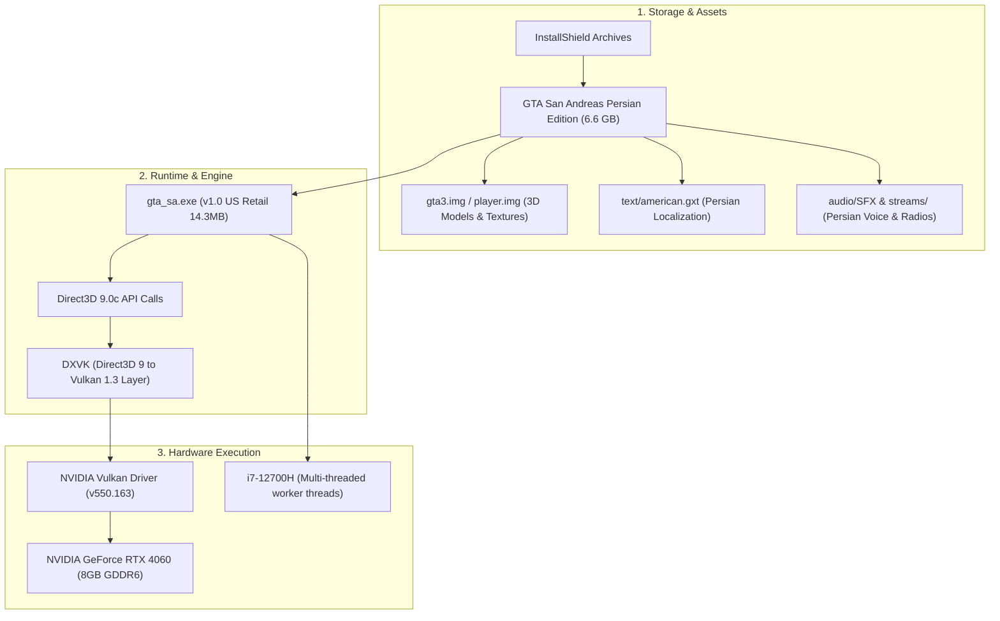

# Grand Theft Auto: San Andreas - Linux Engine & GPU Architecture

## 1. Executive Summary
This document outlines the architecture for executing, modding, and porting Grand Theft Auto: San Andreas (Persian Edition) on Debian/Kali Linux with an Intel Core i7-12700H (20 threads) and an NVIDIA GeForce RTX 4060 Mobile (8GB VRAM).

---

## 2. Component Pipeline

---

## 3. The 4 Development Tiers Built in this Workspace

### Tier 1: Graphics & Shaders (RTX 4060 Vulkan Acceleration)
- **Location:** `dev/tier1_graphics/`
- **Config:** `dxvk.conf` tuned specifically for NVIDIA Ada Lovelace (RTX 4060):
  - Async Vulkan pipeline compilation
  - 16x Anisotropic filtering
  - Uncapped high-refresh framerates
- **Runner:** `launch_rtx_vulkan.sh` automatically forces NVIDIA Prime Render Offloading with real-time HUD displaying FPS, frametime, VRAM usage, and GPU temperature.

### Tier 2: C++ Systems & Gameplay Plugins
- **Location:** `dev/tier2_plugins/`
- **Header:** `include/gta_sa_defs.h` with reverse-engineered memory addresses for GTA SA v1.0 US (`CTimer`, `FindPlayerPed`, `GameState`, frame limits).
- **Source:** `src/gpu_stats_plugin.cpp` template demonstrating memory read/write hooks and game loop events.
- **Build System:** `CMakeLists.txt` supporting Clang/GCC and MinGW cross-compilation.

### Tier 3: Persian Content & Asset Scripting
- **Location:** `dev/tier3_content/`
- **GXT Tool:** `tools/gxt_tool.py` parses all 127 text tables and 16,588 localized strings from `american.gxt`. Supports search, JSON export, and editing.
- **IMG Tool:** `tools/img_tool.py` parses GTA3.IMG v2 archives containing 16,316 3D models (`.dff`), textures (`.txd`), and collisions (`.col`).

### Tier 4: Native Linux Engine (`librw` / Source Reverse-Engineering)
- **Location:** `dev/tier4_native_engine/`
- **Asset Symlinks:** `setup_native_assets.sh` creates direct zero-copy symlinks from the 6.6GB game assets directly into native engine search paths.
